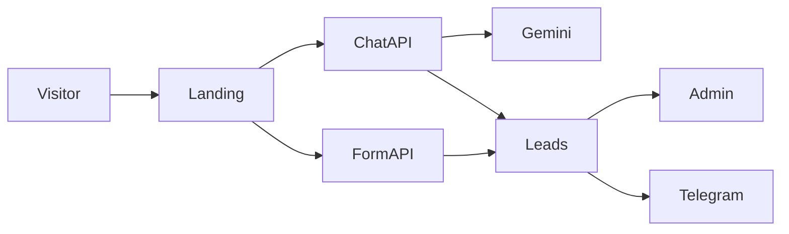

# Лендинг веб-студии с ИИ и админкой заявок

## Стек

- **Next.js (App Router, JavaScript)** + Tailwind CSS — лендинг, API и `/admin` в одном приложении
- **Framer Motion** — появление секций при скролле
- **Lenis** — плавный скролл
- CSS `transform` + лёгкий слой с `data-speed` — параллакс фона/типографики в hero (без тяжёлого GSAP)
- **@google/genai** — модель `gemini-3.5-flash-lite` только на сервере
- Хранение заявок: JSON-файл `data/leads.json` (достаточно для учебного проекта, без БД)
- Telegram: **бот + `sendMessage`** в чат/группу/канал по `TELEGRAM_CHAT_ID` — один код покрывает все три варианта; для команды удобнее группа, куда добавлен бот

## Визуальный язык

Не SaaS-карточки «из шаблона». Направление: **вечерняя студия вёрстки** — тёмно-синий `#0E1A2B`, бумага `#F4EDE3`, акцент циан-лазурь `#2EC4B6`, вторичный охра `#C45C26`. Шрифты: **Fraunces** (заголовки) + **Manrope** (текст). Hero — крупный оффер и слой параллакса (сетка макета / крупные буквы «STUDIO»), не градиентная карточка со статистикой.

Переключатель темы в шапке; `localStorage` + класс на `html`.

## Страницы и секции

Публичный лендинг `/`:

1. **Hero** — оффер веб-студии (сайт под заявки за фиксированный срок), CTA «Оставить бриф» и «Спросить ИИ»
2. **Преимущества** — 4 конкретных пункта (срок, ИИ-бриф, прозрачная смета, сопровождение)
3. **Отзывы** — 3 кейса с цифрами (не шаблонные «всем рекомендую»)
4. **FAQ** — аккордеон
5. **Форма заявки** — имя, телефон, тип сайта, комментарий
6. Плавающий **ИИ-виджет**

Админка [`/admin`](app/admin/page.js): логин по `ADMIN_PASSWORD`, таблица заявок (дата, имя, контакт, источник: форма / чат / квиз, статус), детали диалога, смена статуса «новая / в работе / закрыта».

## ИИ: чат + мягкий квиз

- Виджет чата, ключ Gemini **не** на клиенте
- API [`app/api/chat/route.js`](app/api/chat/route.js): system prompt про услуги студии, цены-ориентиры, сроки; запрет выдумывать факты вне брифа
- Сценарий: ответы на вопросы → 3–4 шага квиза (тип сайта, цель, срок, бюджет) → мягкий запрос контакта
- Когда ИИ собрал имя+телефон, сервер сам создаёт заявку (тот же пайплайн, что у формы)
- Короткая история диалога в сессии виджета (без аккаунтов)

## Заявки и Telegram

- API [`app/api/leads/route.js`](app/api/leads/route.js) пишет в `data/leads.json` и вызывает `sendTelegramLead()`
- Текст в Telegram: имя, телефон, источник, комментарий/итог квиза
- Если токен не задан — заявка всё равно сохраняется, ошибка Telegram логируется, форма не падает

Переменные в `.env.local`:

- `GEMINI_API_KEY`
- `TELEGRAM_BOT_TOKEN`
- `TELEGRAM_CHAT_ID`
- `ADMIN_PASSWORD`
- `ADMIN_SECRET` (подпись cookie сессии)

Админ API защищён cookie после `POST /api/admin/login`.

## Ключевые файлы

- [`app/page.js`](app/page.js) — секции лендинга
- [`app/globals.css`](app/globals.css) — токены темы, параллакс
- [`components/AiAssistant.js`](components/AiAssistant.js) — чат + квиз
- [`components/LeadForm.js`](components/LeadForm.js)
- [`lib/leads.js`](lib/leads.js), [`lib/telegram.js`](lib/telegram.js), [`lib/gemini.js`](lib/gemini.js)
- [`app/admin/page.js`](app/admin/page.js)

## Проверка

После реализации: `npm run dev`, пройти форму и чат-квиз, открыть `/admin`, проверить появление заявки. Telegram проверим, если в `.env.local` будут токен и chat id (их нужно будет подставить вам). Браузерную проверку лендинга (скролл, тема, виджет, форма) сделаю в конце.